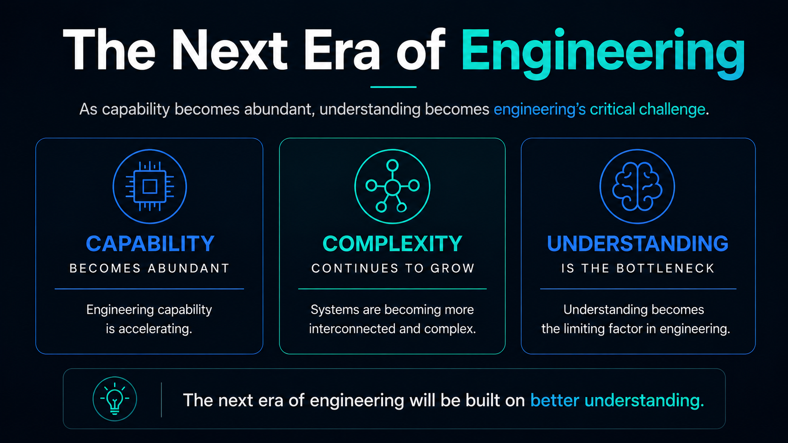
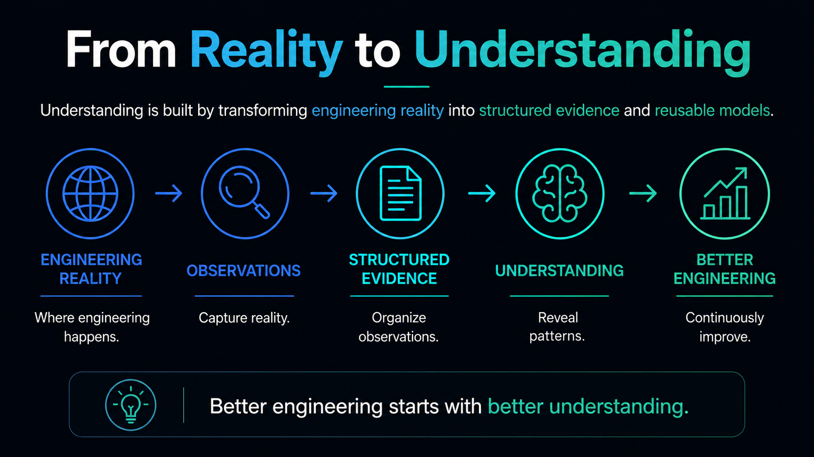

# Continufy


<p align="center">
  
</p>

Continufy is the umbrella identity for a family of independent research and engineering projects focused on software understanding, scientific instrumentation, structural analysis, and execution legitimacy.

It does not operate the projects, define their internal authority, or collapse them into one runtime. Each repository remains independently scoped and owns its own artifacts, methods, decisions, and boundaries.

## Why Continufy

Organizations define how work should happen. Continufy explores how that work can become representable, governable, executable, measurable, and improvable without confusing a recommendation with authority.

**Intelligence is not enough.**

```text
Observation ≠ Evidence
Evidence ≠ Theory
Reasoning ≠ Permission
Candidate ≠ Action
Execution ≠ Successful Outcome
```

An intelligent system may reason well and still lack sufficient evidence, current state, authority, execution eligibility, or proof that an action produced the intended outcome.

Continufy preserves the boundaries between understanding, legitimacy, execution, and outcomes—so intelligence can participate in work without becoming authority merely because it is intelligent.

A practical operating pattern is:

```text
Observe
        ↓
Represent
        ↓
Evaluate
        ↓
Validate
        ↓
Authorize
        ↓
Execute
        ↓
Prove
        ↓
Measure
        ↓
Learn
        ↓
Improve
        ↓
Repeat
```

This pattern is descriptive at the umbrella level. Continufy does not itself grant authority, determine execution eligibility, or execute actions. Those responsibilities remain with the repositories, contracts, and authority boundaries that own them.

## Purpose

Continufy provides a shared home for projects exploring a broader progression:

```text
Reality
        ↓
Understanding
        ↓
Evidence
        ↓
Theory
        ↓
Analysis
        ↓
Trusted Action
```

This progression is descriptive rather than executable. No artifact advances automatically, and no repository gains authority over another merely by appearing earlier in the sequence.


<p align="center">
  
</p>


## Projects

- **MindShift** — a non-operational instrument for transforming observations into transferable abstractions.
- **Research Methodology** — reusable contracts and principles for conducting rigorous research.
- **Architectural Boundary Research** — empirical investigation of recurring architectural patterns and boundaries.
- **Structology** — domain-neutral study of objects, relations, boundaries, transitions, contexts, and invariants.
- **Structural Analysis Foundations** — formal definitions, theory, and canonical research objects for structural analysis.
- **SYNAPSE** — deterministic structural analysis that transforms topology into reproducible structural evidence.
- **ContinuityOS** — legitimacy infrastructure for determining whether proposed actions are eligible to execute.

## Shared Direction

The projects share an interest in building reusable instruments rather than only producing isolated outputs.

```text
Question
        ↓
Instrument
        ↓
Artifacts
        ↓
Evidence or Models
        ↓
Review
        ↓
Improved Understanding
```

Each project specializes this pattern differently. Continufy provides the umbrella narrative, while responsibility remains local to each repository.

## Data and Evidence Learning System (Proposed)

The Data and Evidence Learning System (DELS) is a proposed cross-project learning pattern for turning source material and operational experience into traceable observations, assessable evidence, and carefully reviewed improvements. It makes the existing Observe → Measure → Learn → Improve direction more explicit without creating a new central runtime or changing repository ownership.

DELS is a conceptual coordination model, not a claim that a unified implementation or automated learning pipeline already exists.

### Learning cycle

```text
Sources and operational activity
        ↓
Data intake and source registration
        ↓
Observations
        ↓
Evidence records
        ↓
Measurement and assessment
        ↓
Learning candidates
        ↓
Independent review and acceptance
        ↓
Versioned model, method, or instrument improvement
        ↺
Future observation and measurement
```

Each transition has a distinct meaning:

- **Data** is collected source material or recorded state. It retains source identity, acquisition context, timestamps where available, and relevant schema or version information.
- **Observation** is a bounded record of what was seen or measured. It should remain distinguishable from interpretation.
- **Evidence** is an observation or artifact assessed for a stated question or claim. Admissibility, quality, and sufficiency are separate assessments; the presence of data alone does not establish any of them.
- **Measurement and assessment** apply declared metrics, decision rules, comparison bases, and limitations. Results may be positive, negative, null, unsupported, or indeterminate.
- **Learning candidate** is a proposed pattern, abstraction, model change, or instrument improvement derived from reviewed evidence. It is a proposal, not an accepted change.
- **Accepted improvement** is versioned and traceable to its rationale, supporting evidence, review, owner, and affected artifact. It applies only within the scope authorized by that owner.

### Evidence and provenance discipline

Learning quality depends on preserving the chain from source to conclusion. Where applicable, records should identify:

- the originating source and its stable identity or location;
- acquisition time, observation context, and relevant scope;
- schema, method, instrument, and model versions used;
- transformations, exclusions, and normalization steps;
- links between observations, evidence records, assessments, and claims;
- uncertainty, limitations, missing information, and contrary evidence;
- the reviewer and disposition of any proposed change.

Do not silently promote interpretation into observation, correlation into causation, internal conformance into external effectiveness, or an unresolved result into a positive or negative finding. Preserve negative and indeterminate outcomes because they constrain what can legitimately be learned.

### Repository ownership and exchange boundaries

DELS does not centralize the responsibilities of the projects listed above. Each repository remains the authority for its own methods, canonical artifacts, validation rules, and acceptance decisions. Cross-project exchange should use explicit, versioned artifacts with provenance; a downstream project may assess an input but does not thereby gain control over its producer.

- **MindShift** may produce observations, candidate patterns, and abstractions. Those outputs remain candidates until evaluated by the relevant method or owner.
- **Research Methodology and research instruments** define how questions are investigated, what is measured, and how outcomes and limitations are recorded.
- **Architectural Boundary Research** owns its empirical executions, evidence, calibration, and transfer determinations.
- **Structology and Structural Analysis Foundations** own their conceptual and formal definitions and the evidence required to revise them.
- **SYNAPSE** owns its deterministic structural-analysis methods and outputs.
- **ContinuityOS** owns legitimacy, authority, execution-eligibility, and execution-boundary determinations. DELS outputs do not grant permission or make an action executable.

### Learning is governed, not automatic

```text
Observation ≠ Evidence
Evidence ≠ Interpretation
Interpretation ≠ Accepted Model
Learning Candidate ≠ Approved Change
Validation ≠ Authority
```

DELS may inform a proposal to revise a model, methodology, instrument, or operational procedure. It does not silently rewrite persistent instructions, policies, authority structures, or execution rules. Any change capable of affecting future execution eligibility must pass the governance and authorization process of the system that owns that boundary.

The intended benefit is cumulative learning with traceable provenance: repeated work can improve future instruments and decisions, while preserving uncertainty, independent review, repository autonomy, and the distinction between understanding and legitimacy.

## Program Coordination

- [Canonical Continufy Research & Development Instrument Specification](docs/reference-execution/v1.0/canonical-instrument-specification.md) — the immutable, reusable execution contract for Reference Execution v1.0.
- [Reference Execution v1.0 coordination contract](docs/reference-execution/v1.0/coordination-contract.md) — the bounded protocol for coordinating frozen, repository-owned executions without transferring authority to Continufy.
- [Continufy SOP-to-Executable Governance Contract v1.0](docs/sop-governance/v1.0/contract.md) — the domain-neutral, non-runtime contract separating SOP instruction, evidence, decision, authority, eligibility, exact execution, proof, outcome, and revision.

## Boundary Principle

**Conventions for the ordinary. Governance for the consequential.**

Conventions reduce unnecessary choice by providing stable defaults for ordinary, repeatable behavior. Governance applies when an exact action carries consequence, authority, risk, or execution impact and therefore requires explicit evidence, policy, authorization, or proof before it may proceed.

Convention does not create authority, and governance is not a requirement for every implementation detail. The boundary is contextual: ordinary behavior should remain lightweight, while consequential actions must not inherit legitimacy merely because a framework, model, agent, or operator can produce them.

```text
Ordinary, repeatable choice
→ Convention
→ Proceed under established structure

Consequential action
→ Governance boundary
→ Evidence + Authority + Validation
→ Execution eligibility
→ VALID | NULL
```

```text
Shared Identity
≠
Shared Authority
```

```text
Artifact Exchange
≠
Repository Control
```

```text
Umbrella
≠
Runtime
```

Continufy does not authorize research conclusions, formal theory, structural results, or execution. Those determinations remain with the repositories and review boundaries that own them.

## Core Determinations

```text
Training ≠ Instructions
Capability ≠ Cognition
Cognition ≠ Legitimacy
Proposal ≠ Authority
Capability ≠ Permission
Validation ≠ Execution
Trust ≠ Authority
Visibility ≠ Legitimacy
```

AI output is never executable by itself.

## Long-Term View


<p align="center">
  
</p>


Continufy exists to make the relationship between these projects understandable without erasing their independence.

The umbrella connects:

```text
Higher-Quality Abstractions
        ↓
More Rigorous Research
        ↓
Formal Structural Knowledge
        ↓
Deterministic Structural Evidence
        ↓
Better-Governed Engineering Systems
```

The long-term development path is:

```text
Research
        ↓
Scientific Instruments
        ↓
Validated Technologies
        ↓
Developer Platform
        ↓
Enterprise Products
```

This path is aspirational rather than automatic. Each transition depends on evidence, validation, independent review, and demonstrated value.

The value of the umbrella is coherence, not control.
